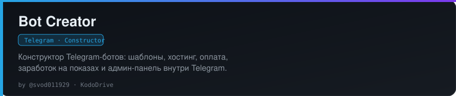
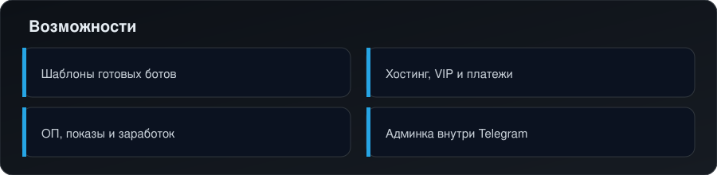

<!-- kododrive-readme-style -->

<div align="center">
  
</div>

<br/>

<div align="center">
  
</div>

<br/>

<p align="center">
  <a href="https://github.com/svod011929/bot-creator"></a>
  <a href="https://t.me/DDDDEVELOPER"></a>
  <a href="https://github.com/svod011929"></a>
  
</p>

<!-- /kododrive-readme-style -->

# Bot Creator

Конструктор Telegram-ботов на **Python 3.10+ / aiogram 3** и **SQLite**. Пользователь выбирает шаблон, подключает токен своего бота и запускает его с хостингом, оплатой, обязательной подпиской и заработком на показах — не оставляя Telegram.

Живой конструктор: [@DDDCReatorBot](https://t.me/DDDCReatorBot). Автор: [KodoDrive](https://github.com/svod011929) · [Telegram](https://t.me/DDDDEVELOPER)

<div align="center">


</div>

<div align="center">
  
</div>

---

## 📋 Содержание

- [Возможности](#-возможности)
- [Стек и архитектура](#-стек-и-архитектура)
- [Структура проекта](#-структура-проекта)
- [Установка и запуск](#-установка-и-запуск)
- [Переменные окружения](#-переменные-окружения)
- [Тесты](#-тесты)
- [Деплой](#-деплой)
- [Автор](#-автор)
- [Проекты KodoDrive](#проекты-kododrive)

## ✨ Возможности

### 🧩 Шаблоны дочерних ботов

В конструкторе четыре готовых шаблона. У каждого — свой игровой или рабочий контур, карточка бота и настройки владельца:

- **Кликер** — тапы, миссии, экспедиции, XP и расписанные события. Демо: [@DDDClickerBot](https://t.me/DDDClickerBot)
- **Реферальный клуб** — кампании, викторины, команды недели и рейтинг клуба
- **Star-бот** — маршруты, карточки знаний, созвездия и тематические обучающие треки. Демо: [@DDDFreeStarsBot](https://t.me/DDDFreeStarsBot)
- **Микрозадачи** — задания и выводы. Демо: [@DDDMicroTasksBot](https://t.me/DDDMicroTasksBot)

Владелец оформляет приветствие и внешний вид в студии запуска, ведёт каталоги контента и смотрит активность пользователей.

### 🏠 Хостинг и VIP

Создание бота оплачивается по тарифу шаблона. Дальше списываются дни хостинга, есть стартовый пакет дней и отдельный VIP-тариф. Цены задаются в окружении и правятся в админке, без правок кода.

### 💳 Платежи

Пополнение баланса конструктора и оплаты идут через [LavePay](https://t.me/laveshka?startapp=ref_p8lzxfvu). Владелец дочернего бота может подключить свой магазин для выводов USDT TRC-20. Вывод заработанного в конструкторе — заявками, с подтверждением назначенного сотрудника. Автоматически деньги никуда не уходят.

### 📣 Обязательная подписка и источники трафика

В дочерних ботах подключаются **TGrass** и **PiarFlow**: задания на подписку, награды, вебхуки отписок и штрафы. Ключи и токены источников живут только у конструктора, в процесс дочернего бота они не передаются.

### 📡 Заработок на показах (MGRAM)

Владелец может подключить заработок на показах рекламы в своём боте. Партнёрский ключ хранится только в окружении конструктора и не попадает в дочерний процесс.

### 💡 Идеи и обратная связь

Пользователи предлагают идеи и голосуют за них в разделе «Информация». Если администратор принимает идею, автор один раз получает награду на баланс. Размер награды настраивается в админке (по умолчанию 50 ₽).

### 📰 Новости

Из админки можно опубликовать новость: сообщение уходит пользователям конструктора и, если бот — администратор канала, дублируется в канал.

### 🔒 Подписка на канал и чат конструктора

Опциональный входной фильтр: пользователь подписывается на канал и чат конструктора, чтобы пользоваться меню. Админы, команда `/start` и юридические документы проверку не проходят. Работают публичные `@username` и закрытые пригласительные ссылки (для закрытых конструктор должен быть администратором, нужен числовой ID чата). По умолчанию фильтр выключен и включается в настройках.

### 📄 Документы

В «Информации» — пользовательское соглашение, политика конфиденциальности и оферта: короткий текст в чате и полная версия в PDF.

### 🛠 Админ-панель

Панель доступна только администраторам, внутри Telegram:

- пользователи, поиск, журнал операций;
- рассылки и новости;
- финансы, заявки на вывод, экран «Цены и тарифы»;
- источники TGrass / PiarFlow;
- идеи пользователей;
- настройки: обязательная подписка, контакты поддержки, награда за идеи.

## 🏗 Стек и архитектура

- **Язык и фреймворк:** Python 3.10+, aiogram 3
- **База:** SQLite (учёт конструктора отдельно от баз дочерних ботов)
- **Процессы:** конструктор запускает дочерние боты через супервизор
- **Режимы дочерних ботов** (`CHILD_RUNTIME`):
  - `process` — отдельный процесс на каждый бот (по умолчанию);
  - `shared` — один worker-процесс и Unix-сокет, удобнее при большом числе ботов

Секреты конструктора (токен, платёжные ключи, ключи источников, партнёрский ключ, ключ шифрования выводов) в окружение дочернего процесса не передаются: туда попадает только явный белый список переменных.

## 📁 Структура проекта

```
bot-creator/
├── creator/          # конструктор: хендлеры, биллинг, супервизор, интеграции
├── child/            # шаблоны и рантайм дочерних ботов
├── tests/            # pytest
├── docs/             # описания шаблонов и студий
├── scripts/          # вспомогательные проверки
├── .env.example      # имена переменных, без значений
├── requirements.txt
└── pyproject.toml
```

Запуск конструктора: `python -m creator`. Проверка без Telegram: `python -m creator --dry-run`.

## 🚀 Установка и запуск

### 1. Клонировать репозиторий

```bash
git clone https://github.com/svod011929/bot-creator.git
cd bot-creator
```

### 2. Установить зависимости

```bash
python3 -m venv .venv
source .venv/bin/activate
pip install -r requirements.txt
```

### 3. Настроить окружение

Скопируйте `.env.example` в `.env` и заполните значения локально. Файл `.env` в репозиторий не коммитится. Токены, ключи и секреты вебхуков нельзя публиковать в чате и в git.

```bash
cp .env.example .env
```

Минимум для запуска: `BOT_TOKEN` и `ADMIN_IDS`. Остальные переменные подключают платежи, источники, вебхуки и тарифы.

### 4. Запустить

```bash
python -m creator
```

Или только сборка и проверка шаблонов, без обращения к Telegram:

```bash
python -m creator --dry-run
```

## ⚙️ Переменные окружения

Ниже только **имена**. Значения задаются в локальном `.env`, в репозитории их нет.

### Основные

| Переменная | Назначение |
| --- | --- |
| `BOT_TOKEN` | Токен бота-конструктора |
| `ADMIN_IDS` | Telegram ID администраторов |
| `ADMIN_URL` | Ссылка на администратора в «Информации» |
| `CHAT_URL` | Ссылка на чат конструктора |
| `CHANNEL_URL` | Ссылка на канал конструктора |
| `CHANNEL_CHAT_ID` | Числовой ID канала (для закрытых ссылок) |
| `CHAT_CHAT_ID` | Числовой ID чата (для закрытых ссылок) |
| `DATA_DIR` | Каталог данных и баз |
| `LAUNCH_DATE` | Дата запуска, если нужна в интерфейсе |
| `LOG_LEVEL` | Уровень логов |
| `CHILD_RUNTIME` | `process` или `shared` |

### Тарифы

`PRICE_CLICKER`, `PRICE_REFBOT`, `PRICE_STARBOT`, `PRICE_MICROTASKS`, `HOSTING_DAY_PRICE`, `START_HOSTING_DAYS`, `VIP_PRICE`, `REF_PERCENT`, `RESALE_FEE_PERCENT`

Их же можно менять в админке, на экране «Цены и тарифы».

### Платежи и выводы

`LAVEPAY_API_KEY`, `LAVEPAY_BASE_URL`, `LAVEPAY_WEBHOOK_SECRET`, `LAVEPAY_WEBHOOK_HOST`, `LAVEPAY_WEBHOOK_PORT`, `WITHDRAW_APPROVER_ID`, `WITHDRAW_METHODS`, `CHILD_LAVEPAY_PAYOUTS`, `CHILD_LAVEPAY_PAYOUTS_AUTO`, `CHILD_LAVEPAY_DAILY_LIMIT_RUB`, `OWNER_PAYOUT_KEY`

### Источники трафика и показы

`TGRASS_FACTORY_TOKEN`, `TGRASS_OWNER_ID`, `TGRASS_OWNER_USERNAME`, `TGRASS_HUB_API_KEY`, `TGRASS_BASE_URL`, `TGRASS_REWARD`, `TGRASS_MIN_USERS`, `PIARFLOW_TOKEN`, `PIARFLOW_HUB_API_KEY`, `PIARFLOW_BASE_URL`, `PIARFLOW_REWARD`, `PIARFLOW_MIN_USERS`, `MGRAM_PARTNER_API_KEY`

### Вебхуки

`WEBHOOK_PUBLIC_BASE`, `WEBHOOK_LISTEN_HOST`, `WEBHOOK_LISTEN_PORT`

## 🧪 Тесты

```bash
pip install -r requirements-dev.txt
pytest
```

Дополнительно в `requirements-dev.txt` есть Ruff. Тесты не ходят во внешние платёжные системы и не требуют боевых токенов.

## 🚢 Деплой

Краткие правила, без привязки к конкретной машине:

1. Держите `.env`, базы и логи вне git. В публичный репозиторий попадает только пример с именами переменных.
2. Перед обновлением сделайте резервную копию кода, базы и конфигурации.
3. Поставьте зависимости в виртуальное окружение и запускайте `python -m creator` через systemd или другой менеджер процессов.
4. Для многих дочерних ботов удобен `CHILD_RUNTIME=shared`.
5. Если включены вебхуки, наружу должна быть доступна только точка из `WEBHOOK_PUBLIC_BASE`.
6. Не переносите секреты конструктора в конфиги дочерних ботов и не публикуйте их в переписке.

## 👤 Автор

[svod011929](https://github.com/svod011929) · [KodoDrive](https://t.me/KodoDriveBio) · [@DDDDEVELOPER](https://t.me/DDDDEVELOPER)

<!-- kododrive-projects-block -->

## Проекты KodoDrive

Другие проекты автора: [профиль @svod011929](https://github.com/svod011929) · [Telegram](https://t.me/DDDDEVELOPER)

### VPN и инфраструктура

- [BuryatVPN — VPN-сервис + Telegram](https://github.com/svod011929/buryatvpn)
- [VPN Server Installer — VLESS + TLS](https://github.com/svod011929/vpn-server-installer)
- [3X-UI Auto Installer](https://github.com/svod011929/3x-ui-auto-installer)
- [AWG Bot Installer — AmneziaWG](https://github.com/svod011929/awg-bot-installer)
- [RemnaShop Installer](https://github.com/svod011929/remnashop-installer)
- [VPN Auto Installer — панели](https://github.com/svod011929/vpn-auto-installer)
- [VPNHubBot — Telegram VPN-бот](https://github.com/svod011929/VPNHubBot)

### Telegram и автоматизация

- [KDS Server Panel — SSH из Telegram](https://github.com/svod011929/KDS_Server_Panel)
- [Telegram → VK Poster](https://github.com/svod011929/telegram-to-vk-poster)
- [KDS Parser CryptoBot](https://github.com/svod011929/kds_parser_cryptobot)
- [Auction Bot](https://github.com/svod011929/auction-bot)
- [Invest Bot](https://github.com/svod011929/invest-bot)
- [Crypto Check Bot](https://github.com/svod011929/crypto-check-bot)
- [KodoRefStarsBot](https://github.com/svod011929/KodoRefStarsBot)
- [KodoStars](https://github.com/svod011929/KodoStars)
- **Bot Creator** ← ты здесь

### Магазины и финансы

- [KodoCashFlow](https://github.com/svod011929/KodoCashFlow)
- [Telegram Crypto Shop](https://github.com/svod011929/telegram-crypto-shop)
- [TalkProfit](https://github.com/svod011929/talkprofit)

### Сайты

- [KodoDrive Portfolio](https://github.com/svod011929/kododrive-portfolio)
- [kododrive.github.io](https://github.com/svod011929/kododrive.github.io)

<!-- /kododrive-projects-block -->
